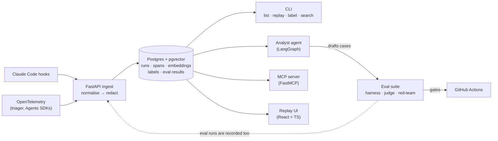

# Project plan

**Agent Flight Recorder** records every AI agent run, replays it as a timeline, finds failure patterns, and turns failed runs into eval cases.

- **Timeline:** five weeks, Mon 2 Nov to Sun 6 Dec 2026
- **Budget:** about 9 hours of building a week. Interview prep runs separately.
- **Tracking:** one [GitHub milestone](https://github.com/sonicjoy/agent-flight-recorder/milestones) per week and one issue per task. Issues labelled `stretch` are the first to cut.
- **Workflow:** one branch and pull request per issue; see [Workflow](#workflow).
- **Visibility:** private until launch (#33).

## Definition of done (6 Dec)

- [ ] Public repo where `docker compose up` plus `afr seed` shows the replay UI with demo runs in under five minutes
- [ ] Records Claude Code sessions (hooks) and OpenTelemetry agent traces, with redaction before anything is stored
- [ ] Eval suite (own harness, golden cases, LLM judge, red-team set) that gates CI
- [ ] Analyst agent that clusters failures and drafts eval cases; MCP server that answers "why did run X fail?"
- [ ] Deployed to Cloud Run and Cloud SQL with Terraform
- [ ] README with architecture, design decisions and eval results; demo GIF; published write-up

## Ground rules

- **Clean room.** No employer code, data, prompts or traces, ever. The project is rebuilt from scratch using only public or self-generated data.
- **Hook scope.** The Claude Code hook is installed only in a project-level `.claude/settings.json` for personal repos, never in user-level settings on a work machine.
- **Dry-run tools.** The demo agent never writes to GitHub or anything else outside this repo.
- **Keys stay local.** The Anthropic API key lives only in a local, git-ignored `.env`: never in GitHub secrets, CI, the deployed instance, issues or logs. CI uses the free Gemini API key from a personal Google account, stored as a GitHub Actions secret.
- **Secrets.** gitleaks runs in pre-commit and CI; the Anthropic key has a spend limit; the GCP project has a budget alert.

## The demo agent and its data

The demo agent is the issue triager. It lives in its own public repo, [sonicjoy/issue-triage-agent](https://github.com/sonicjoy/issue-triage-agent), so it can be shared as a tool on its own: it triages any GitHub repo's issues (labels, milestone, duplicates, regressions). It installs this repo for the provider config, and this repo records its runs over OpenTelemetry, the way it would record any outside agent.

Its bundled dataset is **this project's own issues**. That keeps everything self-contained:

- The issues are ours, so the fixtures can be committed, and CI and the quickstart need no GitHub access.
- Their area labels, `stretch` flag and milestone are real ground truth. Duplicates are marked by a "Duplicate of #N" comment: #3 was filed as a duplicate of #2 on purpose, and the rest are separate tasks, so they're unmarked rather than reviewed ([error analysis](evals/error-analysis.md#caveats)).
- It makes a good story: the agent triages the repo it's recorded in.

The catch is size. About 33 issues is too few for solid evals on its own, so to make up for it (#4, #13):

- About 60 synthetic cases (paraphrased variants of real issues, and tricky ones, drafted with Claude), marked as synthetic so results can be reported separately
- 2–3 repeats of each real issue on each provider, which also measures how consistent the agent is
- Re-exporting the issues as the list grows during the project

## Architecture



Runs arrive from Claude Code hooks and OpenTelemetry, are normalised to one span model, redacted, then stored. Four consumers read the store. The analyst agent closes the loop: it groups failed runs by cause and drafts eval cases, and those cases then guard against regressions in CI.

### Data model (draft)

| Table | Holds |
|---|---|
| `runs` | One agent run or Claude Code session: source, agent, status, start/end, total tokens and cost, attributes |
| `spans` | Tree of steps within a run: kind (agent, llm, tool, step), parent, model, tokens, cost, latency, status, error, redacted input/output, raw attributes |
| `embeddings` | 384-d vectors for run summaries and failed spans (pgvector HNSW) |
| `labels` | Failure modes on runs, from you, the judge or the analyst |
| `eval_results` | Each eval run: case, score, model, git SHA, time, for pass-rate trends |

Eval *cases* are YAML files in `evals/cases/`, not database rows, so they are reviewed in PRs like code.

### Repo layout (target)

```
src/flight_recorder/
  ingest/      FastAPI app: OTLP and Claude Code endpoints, mapping
  redact/      secret and PII redaction
  store/       SQLAlchemy models, Alembic migrations
  search/      embeddings and semantic search
  cli/         `afr` commands
  evals/       harness, judge
  analyst/     LangGraph analyst agent
  mcp/         FastMCP server
evals/cases/              golden and red-team cases (YAML)
ui/                       React + TypeScript (Vite)
infra/terraform/          GCP deployment
docs/                     plan, schema, evals write-ups, decisions/
```

### Stack

| Area | Choice |
|---|---|
| Language and tooling | Python 3.12+, uv, ruff, pyright, pytest, pre-commit, gitleaks, GitHub Actions |
| LLMs | Anthropic (Claude Sonnet and Haiku) locally; Gemini free tier in CI and for the provider comparison (GitHub Models was retired in July 2026); one config switch (`AFR_LLM_MODEL`, `AFR_LLM_CHEAP_MODEL`); per-model prices in `pricing.yaml` |
| Agents | LangGraph; one comparison port to the Claude Agent SDK or OpenAI Agents SDK |
| API and storage | FastAPI, Postgres 16, pgvector, SQLAlchemy 2, Alembic |
| Tracing | OpenTelemetry (OTLP/HTTP); OTel GenAI and OpenInference attributes |
| Embeddings | fastembed with bge-small, run locally |
| Evals | Own harness, then a comparison with promptfoo or DeepEval |
| MCP | FastMCP |
| UI | React, TypeScript, Vite |
| Deploy | Docker, Terraform, Cloud Run, Cloud SQL, Secret Manager |

## Key decisions

Write each one up as a short ADR in `docs/decisions/` when you make it. They feed the README and are good interview material.

1. **OpenTelemetry GenAI conventions as the canonical span model.** Any OTel-instrumented agent works without custom code, and Claude Code hook events are mapped into the same shape. The mapping also accepts OpenInference attributes, since most LangChain instrumentation emits those.
2. **One store: Postgres with pgvector.** No separate graph or analytics database. Fewer moving parts keeps the five-minute install achievable, and JSONB holds raw attributes.
3. **Redact before write.** Raw values are never persisted. The hook does a first pass client-side, ingest enforces it server-side, and only redaction counts are stored.
4. **Local embeddings.** No extra API key, reproducible results, and free to run in CI and the quickstart.
5. **Provider-agnostic LLM layer.** Every agent and the judge run on Anthropic or Gemini (or OpenAI, given a key). Provider comparisons become a by-product of the eval suite, and CI needs no paid key. See [LLM providers](llm-providers.md).
6. **Build the eval harness yourself before using a library**, so eval design is something you can explain end to end, then compare the two honestly.
7. **Eval cases live in git as YAML**, while results live in the database: cases change through review, results accumulate as history.
8. **The server makes no LLM calls.** MCP tools return data (runs, similar failures, labels, eval cases), and the calling agent's own model does the explaining. The analyst runs as a local job. So the deployed instance needs no LLM key.

## Weekly plan

Estimates are build hours. The learning items come from the 5-week prep plan and aren't tracked as issues.

### Week 1 · 2–8 Nov · Demo agent and foundations

**Ships:** a provider-switchable LangGraph issue triager that runs end to end, in a repo with CI.

| Task | Issue | Est. |
|---|---|---|
| Python tooling and CI | #1 | 1h |
| Provider-switchable LLM config | #2 | 0.5h |
| Issue fixtures from this repo, plus synthetic cases | #4 | 1h |
| LangGraph issue triager (moved to [issue-triage-agent](https://github.com/sonicjoy/issue-triage-agent), generalised to any repo) | #5 | 3h |
| *Stretch:* port the triager to an Agents SDK (in issue-triage-agent) | #6 | 1.5h |

**Learning (about 4h):** LangGraph tutorials or the free LangChain Academy course; try the Claude Agent SDK or OpenAI Agents SDK; write the one-page "native framework vs LangGraph" note. Keep that note private, or write it in general terms with no internal details.

### Week 2 · 9–15 Nov · Recorder core

**Ships:** triager runs and Claude Code sessions recorded, redacted, searchable and replayable from the CLI.

| Task | Issue | Est. |
|---|---|---|
| Trace schema, migrations and local Postgres | #7 | 1.5h |
| OTLP ingest endpoint; instrument the triager (in its repo) | #8 | 2.5h |
| Claude Code hook capture | #9 | 1.5h |
| Redaction guardrail at ingest | #10 | 1h |
| Embeddings and semantic search | #11 | 1h |
| CLI: list, show and replay runs | #12 | 1.5h |

### Week 3 · 16–22 Nov · Evals and guardrails

**Ships:** a hand-made failure taxonomy, your own eval harness with golden, judge and red-team cases, and evals failing the build on regressions.

| Task | Issue | Est. |
|---|---|---|
| Generate a run corpus with real failures | #13 | 1h |
| Labelling CLI and hand error analysis (50 runs) | #14 | 2h |
| Eval harness from scratch | #15 | 1.5h |
| Golden eval cases from labelled failures | #16 | 0.5h |
| LLM-as-judge rubric with agreement check | #17 | 1.5h |
| Red-team set: prompt injection and secret leaks | #18 | 1h |
| Evals in CI | #19 | 1h |
| Compare with promptfoo or DeepEval | #20 | 0.5h |
| *Stretch:* provider comparison on the golden set | #21 | 0.5h |

**Learning (about 1.5h):** Hamel Husain's "Your AI Product Needs Evals" and Eugene Yan's "Task-Specific LLM Evals". Read them before the error analysis; starting on the week 2 weekend works well.

This is the heaviest week (about 10.5h with reading). The error analysis is the part to protect, since everything after it depends on it.

### Week 4 · 23–29 Nov · Analyst, MCP and deploy

**Ships:** failures turned into eval cases automatically, run history queryable from Claude Code over MCP, and the recorder live on GCP.

| Task | Issue | Est. |
|---|---|---|
| Analyst agent: cluster failures, draft eval cases | #22 | 3h |
| Evaluate the analyst against your labels | #23 | 1h |
| MCP server | #24 | 1.5h |
| API key auth before deploy | #25 | 0.5h |
| Containerise the API and MCP server | #26 | 0.5h |
| Deploy with Terraform to Cloud Run and Cloud SQL | #27 | 2.5h |
| *Stretch:* record the recorder's own agents | #28 | 0.5h |

**Optional:** dbt basics on BigQuery, a weekend extra that's not part of this repo.

### Week 5 · 30 Nov – 6 Dec · Replay UI and launch

**Ships:** a public repo with a working UI, a five-minute quickstart, README, demo and write-up.

| Task | Issue | Est. |
|---|---|---|
| Replay UI: run list and timeline | #29 | 4.5h |
| Seed data and five-minute quickstart | #30 | 1h |
| README, architecture diagram and decisions | #31 | 1.5h |
| Demo GIF or 2-minute video | #32 | 0.5h |
| Launch checklist and go public | #33 | 0.5h |
| *Stretch:* metrics dashboard | #34 | 2h |

**Outside the repo:** publish the write-up (for example "What I learned from reading 500 agent runs"), add a Projects section to your CVs, and update LinkedIn.

## If a week runs long

Cut in this order:

1. Metrics dashboard (#34)
2. Self-tracing (#28)
3. Provider comparison (#21)
4. Agents SDK port (#6)
5. Terraform falls back to a documented `gcloud run deploy`, though keep Terraform if at all possible since job ads ask for it
6. The replay UI shrinks to a run list plus a timeline, with no span detail panel

**Never cut:** redaction, the hand error analysis, your own harness, evals in CI, and the quickstart. They're the core of the story.

## Weekly check-in (Sundays)

- Close the week's milestone; move anything unfinished to the next week, or drop it if it's `stretch`
- Note one thing you learned for the write-up
- Check Anthropic spend, Gemini free-tier usage and GCP billing

## Workflow

- One branch per issue, named `<issue>-<short-slug>` (for example `5-langgraph-triager`)
- A pull request with `Closes #<issue>`; CI must pass; you review and merge with a squash merge, so `main` gets one commit per issue
- Changes outside the issues, like updates to this plan, also go through a PR
- Branch protection on `main` (PRs required, CI must pass) is switched on at launch, because protection rules on private repos need a paid GitHub plan

## Open decisions

- [ ] Record the Gemini free-tier rate limits from AI Studio and size the CI eval suite to fit (#2, #19)
- [ ] License, MIT or Apache-2.0, before going public (#33)
- [ ] GCP project and region (#27)
